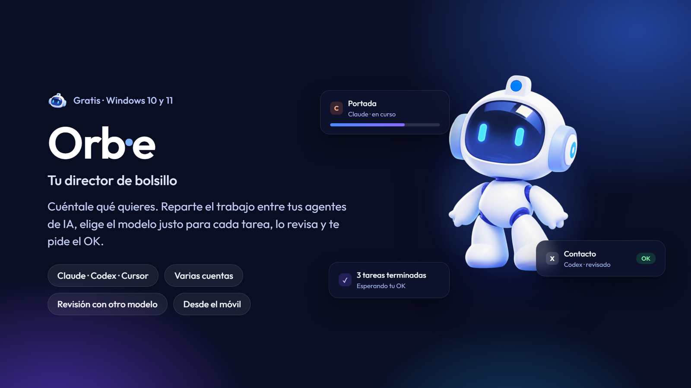

<p align="center"></p>

# Orb·e: Tu director de bolsillo

**Orb** es una aplicación de escritorio para Windows que coordina tus agentes de IA desde un solo chat. Le cuentas qué
necesitas y su asistente, **Orb·e**, planifica el trabajo, lo reparte entre Claude Code, Codex, Cursor, Gemini CLI,
OpenCode, Qwen Code y GitHub Copilot, elige el modelo adecuado para cada tarea y revisa el resultado antes de pedirte el OK.

Todo funciona en tu PC, con tus propias cuentas: Orb no tiene servidor en la nube ni ve tus contraseñas.

Este repositorio es **Orb.dev**, el código de la app. Funcionamiento detallado: [`docs/FUNCIONAMIENTO.md`](docs/FUNCIONAMIENTO.md).
Novedades de cada versión: [`docs/NOVEDADES.md`](docs/NOVEDADES.md).

## Descargar

Desde [**Releases → última versión**](https://github.com/danielfinchdev/orb-dev/releases/latest):

- **`Orb-3.2.1-instalador.exe`** (recomendado): la app completa. Se instala para tu usuario, sin permisos de
  administrador, y se actualiza sola.
- **`Orb-3.2.1-light-portable.exe`**: **Orb Light**, lo esencial sin instalar nada (sin minijuegos, God mode, Monitoreo
  del equipo ni temas). Avisa de las versiones nuevas.

Windows 10 y 11. Al ser una app sin firmar, SmartScreen avisa la primera vez: «Más información» → «Ejecutar de todas
formas». En el primer arranque, Orb instala los agentes que falten con sus instaladores oficiales. El repositorio es
privado: para descargar hace falta acceso en GitHub.

Cada versión se publica automáticamente: al cambiar `version` en `package.json` en `main`, la integración continua la
prueba en Windows, construye el instalador y Orb Light, y los publica en Releases (`.github/workflows/release.yml`).

## Usarla desde el código (para desarrollar)

1. Instala [Git](https://git-scm.com/) y [Node.js 22.13 o superior](https://nodejs.org/).
2. Descárgalo y arráncalo:
   ```bash
   git clone https://github.com/danielfinchdev/orb-dev.git
   cd orb-dev
   npm install
   npm start
   ```
3. En el primer arranque te ofrece instalar lo que falte (Claude Code, Codex, Cursor…). Necesitas **tu propia cuenta** de
   al menos uno de ellos; el inicio de sesión lo hace su programa oficial, la app nunca ve tus contraseñas.
4. Para abrirla otra vez: en la carpeta `orb-dev`, `npm start`. Para tener la última versión: `git pull` y `npm install`
   antes de `npm start` (mejor que un zip: así recibes los arreglos).

El `.exe` no está dentro del código: se descarga de Releases (arriba) o lo generas tú en Windows con `npm run dist`
(deja en `dist\` el instalador y Orb Light).

**Cursor:** su plan gratuito no permite usar el agente desde otras aplicaciones. Si una tarea falla por ese motivo, Orb
lo indica, pausa Cursor durante un día y, si la tarea era para «cualquier agente», la asigna a otro.

## Empezar

1. Abre Orb desde el menú Inicio (o `Orb-3.2.1-light-portable.exe`, o `npm start` si la usas desde el código).
2. Elige su nombre, cómo te llama y dónde crear su carpeta. La carpeta se llama como el asistente: con `D:\` y el nombre
   «Nova» se crea `D:\Nova`; si dejas el nombre por defecto, `D:\Orb`.
3. En **Agentes**, comprueba qué agentes encuentra (Claude Code, Codex, Cursor, Gemini CLI, OpenCode, Qwen Code, Copilot) y
   que tienen la sesión iniciada. Si ya iniciaste sesión en su programa (por ejemplo Codex con tu cuenta de ChatGPT), no
   hace falta nada más; si no, el botón abre el login oficial (la app nunca ve tus contraseñas).
4. Crea un proyecto desde el chat (botón de proyecto bajo el cuadro de texto) y pídele algo.

## La carpeta del asistente

```
D:\Orb\                   (siempre <carpeta elegida>\Orb, igual para todos)
  orb.json                ajustes
  windows\ ios\ android\ web\
                          categorías: cada carpeta dentro de una de ellas es un proyecto
                          (las que crea la app y las que crees tú en el Explorador)
  android\adb-tools\      adb y fastboot de Google, los descarga la app (no es un proyecto)
  bitacora\               configuración de Orb: GENERAL.md (memoria general) y proyectos\ (una por proyecto)
  mcp-servers\            configuración de Orb: los servidores MCP; no sale como proyecto, se gestiona en Ajustes
  .orb\                   datos de la app (oculta): base de datos, clave cifrada, registros, copias para deshacer
```

## Lo principal

- **Conversaciones para dirigirlo todo.** Con el Orquestador activado, Orb·e planifica, reparte y supervisa, en varias
  conversaciones a la vez, cada una con su proyecto y su título. Desactivado, hablas directamente con el agente que
  elijas, en tantas conversaciones como quieras. Nunca hace push ni publica sin ti.
- **El modelo justo para cada tarea.** Orb elige un modelo rápido para lo sencillo y el más capaz solo cuando hace falta,
  según el nivel de gasto que fijes.
- **Tareas con control.** Lo delicado (publicar, borrar, credenciales, pagos, razonamiento alto) espera tu aprobación.
  Cada tarea se puede deshacer, trabajar en una copia aislada con su propia rama y terminar con un informe «OK / Pedir
  cambios».
- **Revisión independiente.** Task Review pide a otro modelo, de otro proveedor si es posible, que audite el trabajo;
  Security Review busca vulnerabilidades y secretos expuestos en todo el proyecto. Ninguno modifica nada.
- **Varias cuentas por agente.** Cada cuenta con su sesión, sus modelos y su uso; el trabajo se reparte entre las que
  tienen uso disponible y espera solo al llegar al límite.
- **Pizarra por proyecto** para dibujar, escribir y adjuntar referencias que Orb·e tiene en cuenta al planificar.
- **Desde el móvil**, sin instalar nada: chat, aprobaciones y seguimiento de tareas, con cifrado de extremo a extremo.
- **Monitoreo del equipo** con Opti Bot: salud, seguridad y red del PC; cualquier cambio requiere tu aprobación.
- **Integración con GitHub** mediante `gh`: publicar proyectos, subir ramas y crear pull requests.
- **God mode** para quien quiera ver más: archivos, cambios de git, historial y actividad alrededor del chat.
- **En español e inglés**, con temas, modo claro y oscuro, y conectores MCP para ampliar las herramientas de los agentes.


## Desarrollo

```bash
npm install
npm start            # compila la interfaz y abre la app
npm test             # pruebas del motor (agentes falsos, sin cuentas)
npm run test:app     # la app entera con Electron (en Linux: xvfb-run -a npm run test:app)
npm run test:movil   # la web app del móvil a tamaño de teléfono
ORB_E2E_EXE=dist/win-unpacked/Orb.exe node test/smoke.e2e.mjs   # prueba la app ya empaquetada
npm run dist         # Orb-3.2.1-instalador.exe y Orb-3.2.1-light-portable.exe (en Windows)
npm run icon         # vuelve a sacar el icono del art work (docs/diseno/art work); luego npm run icon:ico
```

| Carpeta | Qué hay |
|---|---|
| `src/main/` | Electron: ventana, primer arranque, puente seguro, arranque del motor y navegador de los agentes con su ventanita |
| `src/engine/` | Motor (proceso aparte): API, sesiones en directo, planificador, orquestador, bitácoras, GitHub, móvil, instalador, modo experto |
| `src/core/` | Tablero, aprobaciones, seguridad, uso, carpetas y deshacer |
| `src/agents/` | Un adaptador por agente: detectarlo, lanzarlo e interpretar sus eventos |
| `src/mcp/` | Servidor MCP que usan los agentes y el asistente |
| `src/ui/` | Interfaz (React + componentes shadcn/ui + Tailwind, tipografía Outfit) |
| `docs/` | Toda la documentación: índice en [`docs/README.md`](docs/README.md) |
