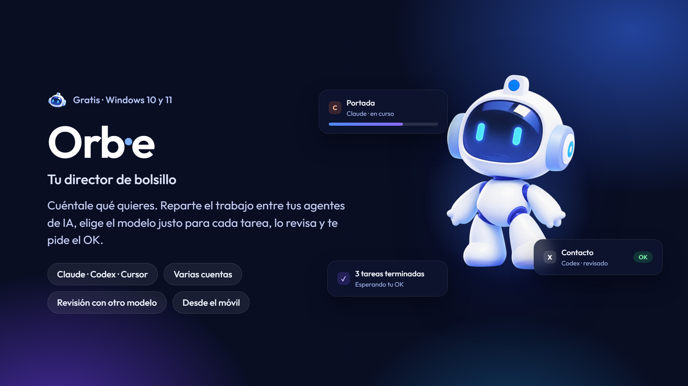

<p align="center"></p>

# Orb·e: Your pocket director

**Orb** is a Windows desktop app that coordinates your AI agents from a single chat. You tell it what you need and its
assistant, **Orb·e**, plans the work, splits it between Claude Code, Codex, Cursor, Gemini CLI, OpenCode, Qwen Code and
GitHub Copilot, picks the right model for each task and reviews the result before asking for your OK.

Everything runs on your PC, with your own accounts: Orb has no cloud server and never sees your passwords.

This repository is **Orb.dev**, the app's source code. How it works, in detail: [`docs/ARCHITECTURE.md`](docs/ARCHITECTURE.md).
What's new in each version: [`docs/CHANGELOG.md`](docs/CHANGELOG.md).

## Download

From [**Releases → latest**](https://github.com/danielfinchdev/orb-dev/releases/latest):

- **`Orb-3.2.1-instalador.exe`** (recommended): the full app. It installs for your user, without administrator
  rights, and updates itself.
- **`Orb-3.2.1-light-portable.exe`**: **Orb Light**, the essentials with nothing to install (no minigames, God mode
  or themes). It tells you about new versions.

- **`Orb-<version>-linux-x86_64.AppImage`** or **`.deb`** (also arm64): the same app for a Linux desktop. The
  AppImage updates itself; the `.deb` tells you about new versions. How to install, update and uninstall:
  [`docs/LINUX.md`](docs/LINUX.md).

Windows 10 and 11. Since the app is not signed yet, SmartScreen warns you the first time: "More info" → "Run anyway".
On first launch, Orb installs any missing agents with their official installers.

Every version is published automatically: when `version` changes in `package.json` on `main`, CI tests it on Windows
and Linux, builds the installer, Orb Light, the AppImage and the `.deb`, and publishes them to Releases
(`.github/workflows/release.yml`).

## Run it from source (for development)

1. Install [Git](https://git-scm.com/) and [Node.js 22.13 or later](https://nodejs.org/).
2. Clone and start it:
   ```bash
   git clone https://github.com/danielfinchdev/orb-dev.git
   cd orb-dev
   npm install
   npm start
   ```
3. On first launch it offers to install whatever is missing (Claude Code, Codex, Cursor…). You need **your own account**
   for at least one of them; sign-in is done by its official program, so the app never sees your passwords.
4. To open it again: `npm start` in the `orb-dev` folder. To get the latest version: `git pull` and `npm install`
   before `npm start` (better than a zip: that way you get the fixes).

The `.exe` is not in the source: download it from Releases (above) or build it yourself on Windows with `npm run dist`
(it leaves the installer and Orb Light in `dist\`).

**Cursor:** its free plan does not allow using the agent from other apps. If a task fails for that reason, Orb says so,
pauses Cursor for a day and, if the task was for "any agent", assigns it to another one.

## Getting started

1. Open Orb from the Start menu (or `Orb-3.2.1-light-portable.exe`, or `npm start` if you run it from source).
2. Choose its name, what it calls you and where to create its folder: `C:\Orb` unless you pick another place (always
   `<chosen folder>\Orb`).
3. In **Agents**, check which agents it finds (Claude Code, Codex, Cursor, Gemini CLI, OpenCode, Qwen Code, Copilot) and
   that they are signed in. If you already signed in to their program (for example Codex with your ChatGPT account),
   nothing else is needed; if not, the button opens the official login (the app never sees your passwords).
4. Create a project from the chat (project button under the text box) and ask it for something.

## The workspace

```
C:\Orb\                   (C:\Orb by default; always <chosen folder>\Orb)
  core\                   Orb's own folder, hidden: settings, database, logs, skills, MCP servers, tools (adb)
  windows\ linux\ ios\ android\ web\
                          categories: each folder inside one of them is a project
                          (the ones the app creates and the ones you create in Explorer)
  multi\<project>\        a multiplatform project: one repository, a folder per platform and compartido\
```

Backups go outside the workspace (`%LOCALAPPDATA%\Orb\copias` by default, or a folder you choose in Settings › Data).
If `core` is deleted, Orb brings back what is missing from the latest backup. A workspace of Orb 3.7 (`.orb`,
`orb.json`, `bitacora`, `mcp-servers` at the top) is moved into `core` the first time 3.8 opens it.

## Highlights

- **Conversations to run everything.** With the Orchestrator on, Orb·e plans, delegates and supervises, in several
  conversations at once, each with its own project and title. With it off, you talk directly to the agent you choose,
  in as many conversations as you like. It never pushes or publishes without you.
- **The right model for each task.** Orb picks a fast model for simple things and the most capable one only when
  needed, according to the spending level you set.
- **Tasks under control.** Sensitive actions (publishing, deleting, credentials, payments, high reasoning) wait for your
  approval. Every task can be undone, run in an isolated copy with its own branch and end with an "OK" / "Request
  changes" report.
- **Independent review.** Task Review asks another model, from another provider when possible, to audit the work;
  Security Review looks for vulnerabilities and exposed secrets across the whole project. Neither changes anything.
- **Several accounts per agent.** Each account with its own session, models and usage; work is spread across the ones
  with usage left and only waits when the limit is reached.
- **A whiteboard per project** to draw, write and attach references that Orb·e takes into account when planning.
- **From your phone**, with nothing to install: chat, approvals and task tracking, with end-to-end encryption.
- **GitHub integration** through `gh`: publish projects, push branches and create pull requests.
- **God mode** for those who want to see more: files, git changes, history and activity around the chat.
- **In Spanish and English**, with themes, light and dark mode, and MCP connectors to extend the agents' tools.


## Development

```bash
npm install
npm start            # builds the UI and opens the app
npm test             # engine tests (fake agents, no accounts)
npm run test:app     # the whole app with Electron (on Linux: xvfb-run -a npm run test:app)
npm run test:movil   # the mobile web app at phone size
ORB_E2E_EXE=dist/win-unpacked/Orb.exe node test/smoke.e2e.mjs   # tests the packaged app
npm run dist         # Orb-3.2.1-instalador.exe and Orb-3.2.1-light-portable.exe (on Windows)
npm run icon         # regenerates the icon from the artwork (docs/diseno/art work); then npm run icon:ico
```

| Folder | Contents |
|---|---|
| `src/main/` | Electron: window, first launch, secure bridge, engine startup and the agents' browser with its mini window |
| `src/engine/` | Engine (separate process): API, live sessions, scheduler, orchestrator, logbooks, GitHub, mobile, installer, expert mode |
| `src/core/` | Board, approvals, security, usage, folders and undo |
| `src/agents/` | One adapter per agent: detect it, launch it and parse its events |
| `src/mcp/` | MCP server used by the agents and the assistant |
| `src/ui/` | UI (React + shadcn/ui components + Tailwind, Outfit typeface) |
| `docs/` | All the documentation: index in [`docs/README.md`](docs/README.md) |

## License

[MIT](LICENSE)
